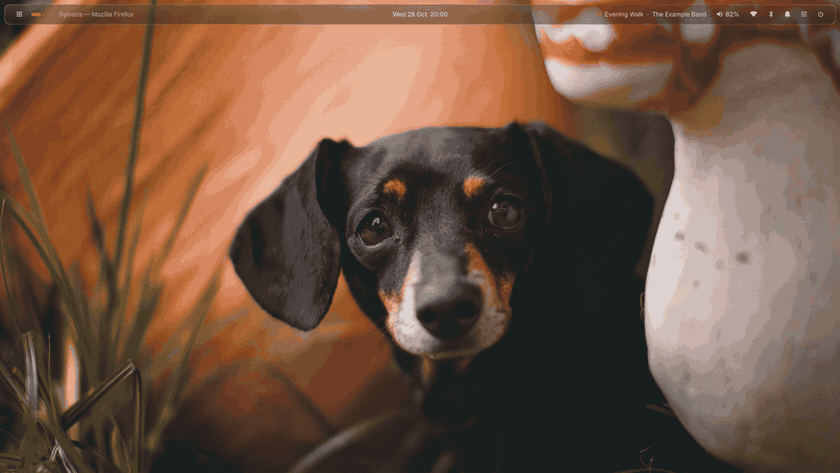
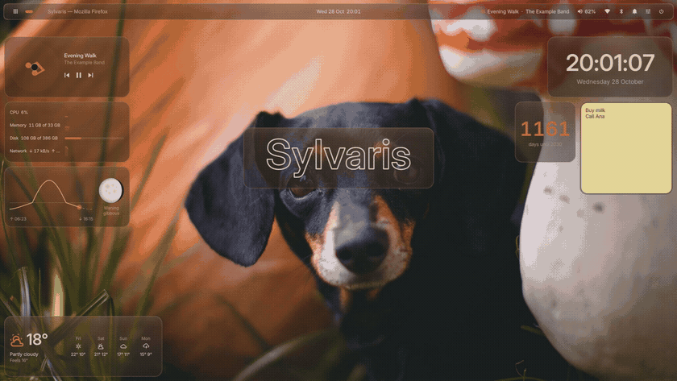
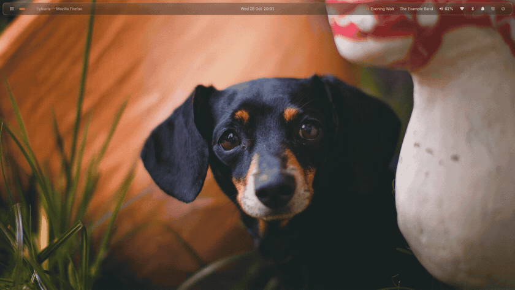

<p align="center">
  
</p>

<h1 align="center">Sylvaris</h1>

<p align="center">
  <b>A modular Wayland desktop shell for Hyprland, niri and sway.</b><br>
  One process, twenty-five parts, and every one of them optional.
</p>

<p align="center">
  <a href="https://sylvaris.fatum.cc">Website</a> ·
  <a href="https://sylvaris.fatum.cc/docs/start.html">Getting started</a> ·
  <a href="docs/README.md">Documentation</a> ·
  <a href="docs/faq.md">FAQ</a> ·
  <a href="docs/compare.md">Compared with other shells</a> ·
  <a href="https://github.com/fatumorg/Sylvaris/discussions">Community</a>
</p>

<p align="center">
  <a href="stack"></a>
  <a href="https://hyprland.org"></a>
  
  
  <a href="https://nixos.org"></a>
  
  <a href="https://github.com/fatumorg/Sylvaris/actions/workflows/check.yml"></a>
</p>

<p align="center">
  
</p>

Sylvaris gives Hyprland, niri and sway a bar, a control center, notifications, a launcher, a dock, a lock and login screen and about twenty other parts, drawn in one glassmorphism design. It is written in QML and JavaScript and runs on SylStack, its own Qt Quick runtime in C++, so it is a finished shell rather than a toolkit like Quickshell or AGS. On NixOS every setting is a typed Home Manager option.

## 🧪 Try it

From a Hyprland, niri or sway session with Nix, start it once without installing anything:

```sh
nix run github:fatumorg/Sylvaris
```

## 🌿 Why Sylvaris

- **One process.** Twenty-five parts run together on SylStack, Sylvaris's own Qt runtime.
- **Only what you enable.** A part you turn off is never loaded, and its tools stay off your `PATH`.
- **Three compositors.** The same shell runs on Hyprland, niri and sway.
- **Scriptable and declarative.** Every switch is a `sylvaris` command, and every setting is a typed Home Manager option.
- **One look everywhere.** Themes preview live, and SylSync makes GTK, Qt, terminals and editors follow them.
- **Looks, not just colours.** Pick Lumen, Classic, Frost, Ink, Neon or Paper to change glass, corners, spacing and type at once, let Sylvaris shuffle them each day, or make a theme from your wallpaper.

## ✨ What's inside

<table>
  <tr>
    <td width="33%" valign="top">
      <h3>🧭 Everyday</h3>
      <b>SylBar</b> glass bar on any edge, or one floating pill<br>
      <b>SylCenter</b> control center with orbits and bento tiles<br>
      <b>SylClock</b> live sky, weather, calendar<br>
      <b>SylNotify</b> notifications as quiet toasts or a fanned stack<br>
      <b>SylIsland</b> live activities you can control<br>
      <b>SylDeck</b> dock that hides when windows open<br>
      <b>SylPad</b> launcher, grid or list<br>
      <b>SylWidget</b> clocks, notes, now playing and more on the desktop<br>
      <b>SylPaper</b> wallpapers per theme and screen
    </td>
    <td width="33%" valign="top">
      <h3>🛠️ Tools</h3>
      <b>SylSwitch</b> Alt+Tab with previews<br>
      <b>SylClip</b> clipboard history<br>
      <b>SylCapture</b> screenshots and recording<br>
      <b>SylMedia</b> player, equalizer, AirPods<br>
      <b>SylDiver</b> <a href="https://diver.fatum.cc">Diver</a> planner and alarms<br>
      <b>SylFiles</b> file manager, as many windows as you like<br>
      <b>SylNotes</b> small editor for notes and code<br>
      <b>SylViewer</b> images and videos over the desktop<br>
      <b>SylArchive</b> zip, rar, 7z and tar as folders<br>
      <b>SylTop</b> task manager with history graphs<br>
      <b>SylTemp</b> temperatures, with an overlay for games<br>
      <b>SylPower</b> power menu constellation
    </td>
    <td width="33%" valign="top">
      <h3>🎨 System</h3>
      <b>SylSettings</b> every setting, searchable<br>
      <b>SylTheme</b> themes with live preview<br>
      <b>SylSync</b> apps follow your theme<br>
      <b>SylLock</b> · <b>SylGreet</b> lock and login<br>
      <b>SylPolkit</b> password prompts<br>
      <b>SylAccessibility</b> zoom and filters<br>
      <b>SylPlugins</b> your own widgets
    </td>
  </tr>
</table>

## 🎬 A closer look

<table>
  <tr>
    <td width="50%"><br><sub><b>SylTheme</b> previews the whole desktop before you pick</sub></td>
    <td width="50%"><br><sub><b>SylSettings</b> with a live preview for every look</sub></td>
  </tr>
  <tr>
    <td width="50%"><br><sub><b>SylPad</b> and <b>SylSwitch</b></sub></td>
    <td width="50%"><br><sub><b>SylDiver</b>, <b>SylClip</b>, <b>SylCapture</b> and <b>SylPower</b></sub></td>
  </tr>
  <tr>
    <td width="50%"><br><sub><b>SylWidget</b> places clocks, notes and now playing on the desktop</sub></td>
    <td width="50%"><br><sub><b>SylTemp</b> shows temperatures in a panel or over a game</sub></td>
  </tr>
</table>

<p align="center"><br><sub><b>SylLock</b>, and SylGreet looks the same at login</sub></p>

## 📦 Install

```nix
{
  inputs.sylvaris.url = "github:fatumorg/Sylvaris";
  inputs.sylvaris.inputs.nixpkgs.follows = "nixpkgs";

  outputs = { sylvaris, ... }: {
    homeConfigurations.me = home-manager.lib.homeManagerConfiguration {
      modules = [
        sylvaris.homeManagerModules.sylvaris
        {
          programs.sylvaris = {
            enable = true;
            bar.position = "top";
            deck = { enabled = true; hide = "windows"; };
            keybinds = { "switcher next" = "ALT+Tab"; "clip toggle" = "SUPER+V"; };
            parts.media = false;
          };
        }
      ];
    };
  };
}
```

Keep the `follows` line, so the lock screen loads PAM modules built from the same nixpkgs as your system. Every setting is a typed Home Manager option. For the lock screen's PAM service and the SylGreet login screen, also import `sylvaris.nixosModules.sylvaris`. Every option is in [docs/nix.md](docs/nix.md). Not on Nix? [docs/install.md](docs/install.md) has steps for Arch, Fedora, Debian, Ubuntu, Linux Mint, openSUSE, Void, Gentoo and every other distribution: `make` builds SylStack, `sudo make install` puts everything in place.

### Requirements

- Linux with Hyprland (Lua or classic config), niri or sway. GNOME, KDE Plasma, COSMIC and X11 are not supported.
- Qt 6.9 or newer. Distributions with an older Qt, such as Linux Mint 22, Ubuntu 24.04 and Debian 13, can use Nix, which brings its own.
- The fonts Inter and JetBrainsMono Nerd Font, which the Nix modules install for you.

[What works on each compositor](docs/compositors.md#what-each-compositor-supports) is generated from the code; the main difference is that sway has no blur.

## 🚀 Start

| Compositor | Add to its config |
|---|---|
| Hyprland (Lua) | `hl.exec_cmd("sylvaris")` in `hl.on("hyprland.start", …)` |
| Hyprland | `exec-once = sylvaris` |
| niri | `spawn-at-startup "sylvaris"` |
| sway | `exec sylvaris` |

Then open **SylSettings** from SylCenter's gear, or run `sylvaris settings`, and type to search any setting. Every switch is also a command:

```sh
sylvaris center           # control center
sylvaris switcher next    # Alt+Tab
sylvaris capture shot area
sylvaris lock
sylvaris set bar.position left
sylvaris list             # everything else
```

## 🪶 Only what you enable

Parts you turn off in `parts` are never loaded, and their tools stay off your `PATH`. Panels are built when you open them; their windows are freed the moment they close and the rest 20 seconds later.

| Measured in the headless harness | Software rendering | GPU (NVIDIA) |
|---|---:|---:|
| Idle, every part on | 150 MB · 0.5 % CPU | 270 MB · 0.5 % CPU |
| After opening every panel once, 25 s later | 168 MB | 348 MB |
| Idle, only the bar and notifications | 101 MB · 0.4 % CPU | 243 MB · 1.6 % CPU |

Resident memory of the Sylvaris process, including SylStack, Qt and, with a GPU, the driver's mappings; CPU is a share of one core over 20 idle seconds. Demo data on one 2560×1440 output with SylStack 1.0.0 and Qt 6.11. Run `tests/bench/bench.sh` to measure on your machine (`BENCH_SETTINGS` takes a `settings.json` to compare setups; set `HL_RENDERER=gles2 HL_QT_BACKEND=rhi` for GPU rendering).

## 📖 Learn more

The [documentation](docs/README.md), also at [sylvaris.fatum.cc](https://sylvaris.fatum.cc), covers every part, command and setting, theme bundles, plugins, Nix and development, one page each. [Questions and answers](docs/faq.md) covers X11, Quickshell, requirements and memory use, and [compared with other shells](docs/compare.md) puts Sylvaris next to Quickshell, AGS, eww and Waybar. [How Sylvaris is built](docs/architecture.md) and [ARCHITECTURE.md](ARCHITECTURE.md) explain the internals, [CONTRIBUTING.md](CONTRIBUTING.md) how to work on it, and [CHANGELOG.md](CHANGELOG.md) what changed.

## 💬 Community

Sylvaris has a forum on [GitHub Discussions](https://github.com/fatumorg/Sylvaris/discussions): [ask a question](https://github.com/fatumorg/Sylvaris/discussions/categories/q-a), [show your desktop](https://github.com/fatumorg/Sylvaris/discussions/categories/show-your-desktop) and its Looks, and follow [announcements](https://github.com/fatumorg/Sylvaris/discussions/categories/announcements). Issues are for bugs.

## 💛 Credits

The constellation idea is inspired by [ilyamiro/serpantinum](https://github.com/ilyamiro/serpantinum). Weather by [Open-Meteo](https://open-meteo.com). AirPods support follows the protocol documented by LibrePods. Made with AI assistance, all changes tested, reviewed and used daily by a real group of people.

## 📄 License

MIT
