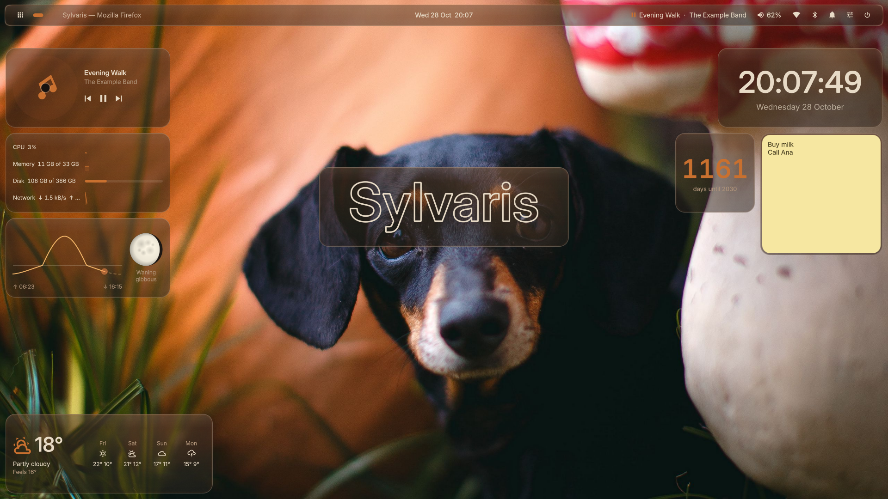
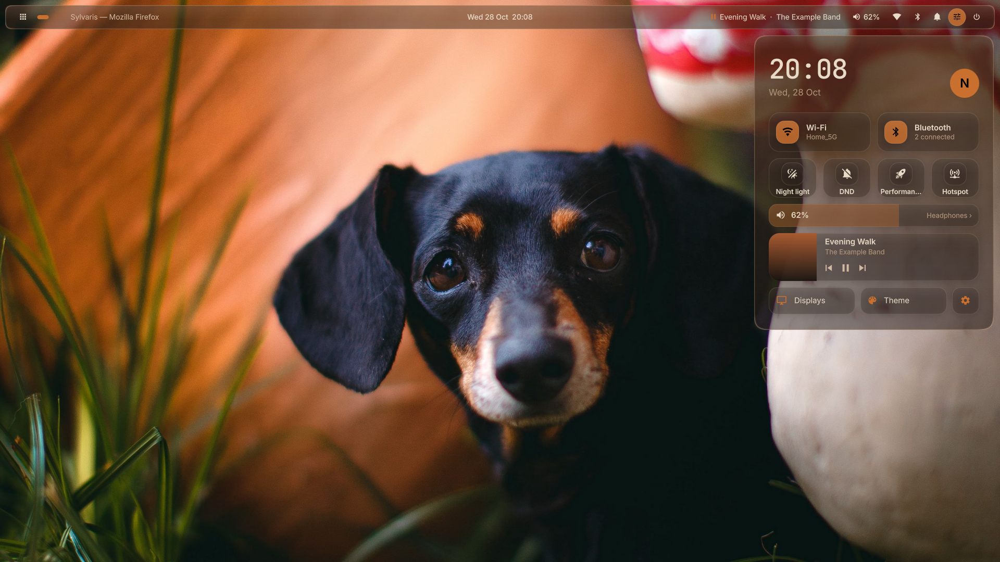
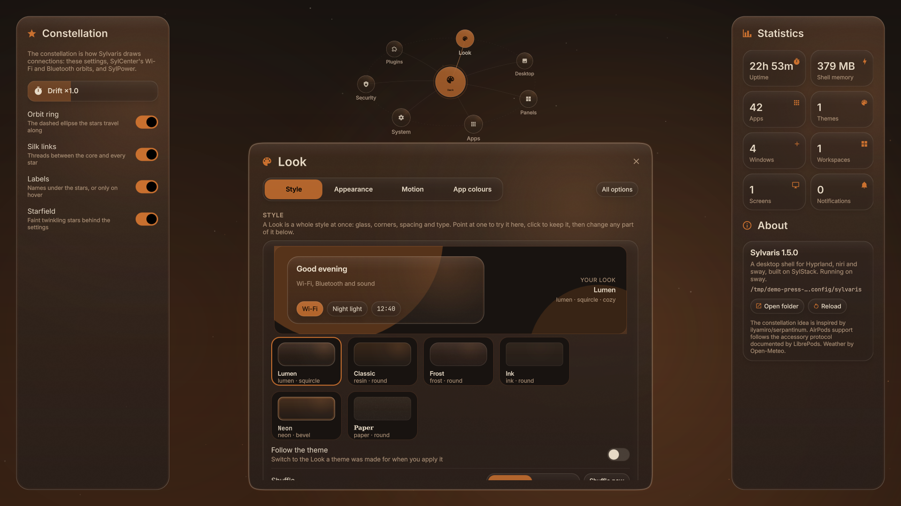
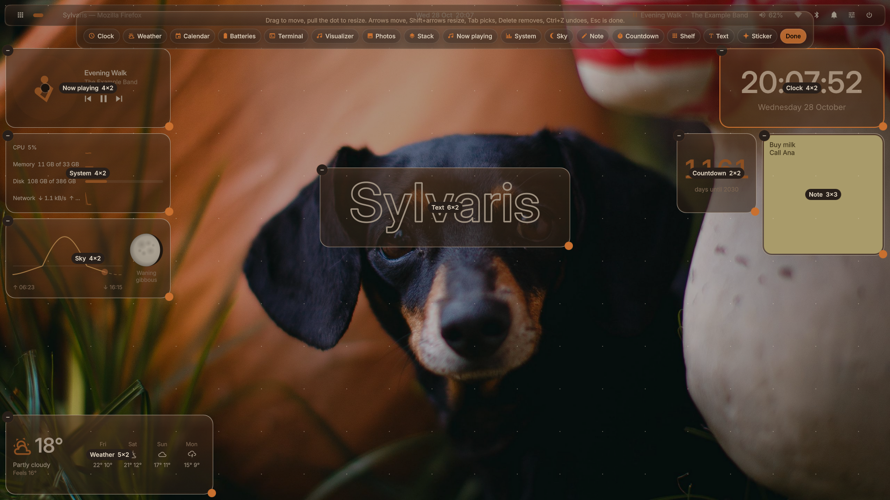
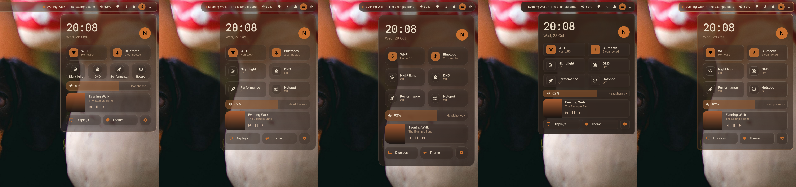
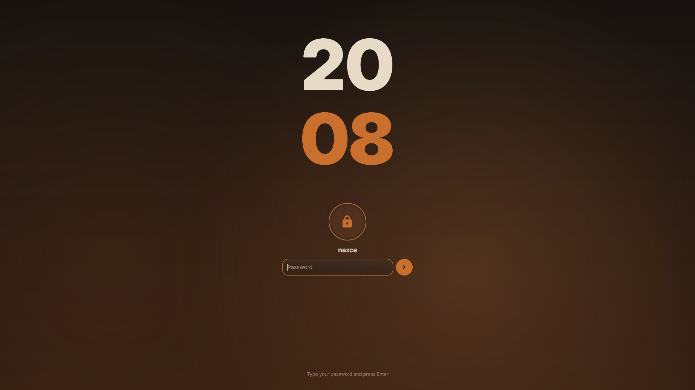

# Press kit

Everything here may be used to write about Sylvaris. No permission is needed; a link to the site is appreciated.

## In 50 words

Sylvaris is a free, MIT-licensed desktop shell for Hyprland, niri and sway. One process draws the bar, a control center, notifications, a live island, a dock, a launcher, desktop widgets, a lock screen and twenty more parts in warm glass, on SylStack, its own small Qt 6 runtime.

## In 150 words

Sylvaris is a free, MIT-licensed desktop shell for the Wayland compositors Hyprland, niri and sway. It brings the pieces a full desktop needs, the bar, a control center, notifications, a live island for music and calls, a dock, a launcher, a file manager, a clipboard history, screenshots, desktop widgets, a lock screen and a login screen, and draws all of them in one process on SylStack, a small Qt 6 runtime written for it.

Every part is optional: one that is turned off never loads. Looks change the glass, corners, spacing and type of the whole desktop at once, themes preview live and carry over to GTK, Qt, terminals and editors, and every setting is a `sylvaris` command and a typed Home Manager option.

Version 1.5 adds a floating bar, a bento control center, notification cards, nine more desktop widgets, hot corners and UI sounds.

## Facts

| | |
|---|---|
| Made by | naxce |
| Licence | MIT |
| Runs on | Hyprland, niri and sway, on any Linux distribution with Qt 6.9 or newer, or anywhere through Nix |
| Built with | QML on SylStack, a C++ and Qt 6 runtime in the same repository |
| Install | Nix flake and Home Manager module, `make install`, AUR |
| Site | [sylvaris.fatum.cc](https://sylvaris.fatum.cc) |
| Source | [github.com/fatumorg/Sylvaris](https://github.com/fatumorg/Sylvaris) |
| Community | [GitHub Discussions](https://github.com/fatumorg/Sylvaris/discussions) |

## Logo

- [Logo, SVG](assets/logo.svg)
- [Logo, PNG](assets/logo.png)
- [Social preview, 1280×640](assets/social.png)

## Screenshots

Full-size files are in [`docs/assets/press`](https://github.com/fatumorg/Sylvaris/tree/main/docs/assets/press). Every screenshot is taken from the headless test harness with demo data.

## Contact

Ask in [GitHub Discussions](https://github.com/fatumorg/Sylvaris/discussions) or open an issue; naxce answers there.
